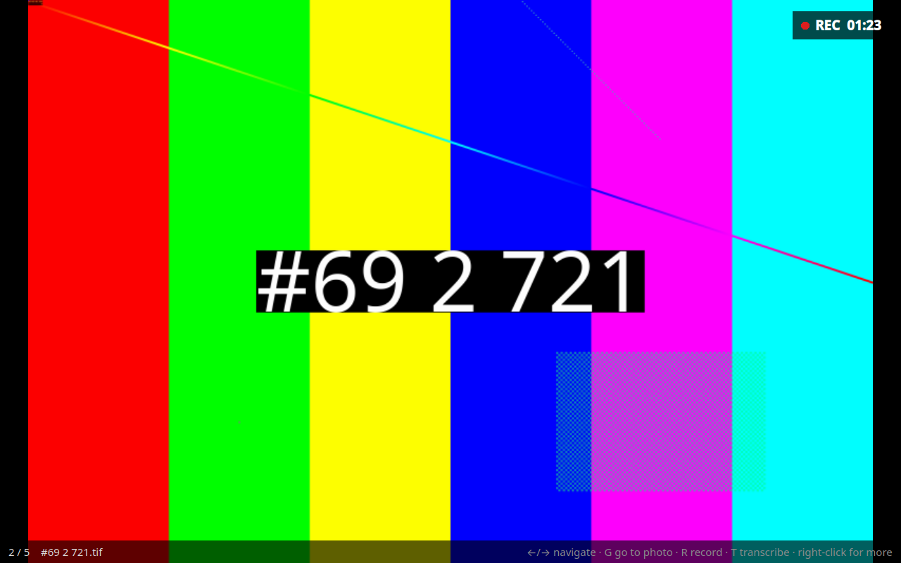

# Photo Voicenotes

Catalogue old scanned photos by talking about them.

You have thousands of scans with names like `#69 2 721.tif`, and someone who knows who and
what is in them, but not the filenames. Photo Voicenotes shows the photos full screen, records
them describing each one as they flip through, and turns that into a spreadsheet with one row
per photo. Nobody has to read a filename aloud.



Everything runs on your own computer. Speech recognition uses
[whisper.cpp](https://github.com/ggml-org/whisper.cpp) locally; the only time the app uses the
internet is a one-off download of the speech-recognition model, which it asks about first.
Your photos are never modified, moved or copied.

## How it works

1. Open a folder of scans. Arrow keys move between photos.
2. Press **R** and talk about each photo as you go: who, where, roughly when.
3. Press **R** again. The app transcribes the recording in the background and works out which
   words were said about which photo, from when each photo was on screen.
4. You get a CSV like this (an invented example):

   ```csv
   filename,description
   #69 2 721.tif,"That's Auntie Jean and Grandpa in the garden at Rose Cottage, summer '78."
   #69 3 722.tif,Same again.
   #69 4 723.tif,
   #70 1 724.tif,"The beach at Lakeside, I think. Peter's first holiday."
   ```

   Every photo shown gets a row, even if nothing was said about it.

The matching allows for how people actually talk: if you press "next" before finishing a
sentence, the end of the sentence stays with the photo it started on. Photos you flip past in
under a second are treated as skipped.

> **Status:** early development, tested on Fedora Linux with an AMD graphics card.
> Packaged downloads for Linux, Windows and macOS are planned; for now you run it from source
> and build whisper.cpp yourself, as below.

## Installing on Linux

You need [uv](https://docs.astral.sh/uv/) (it installs the right Python and the app's
dependencies), and the tools to build whisper.cpp. On Fedora:

```sh
sudo dnf install uv git cmake gcc-c++ vulkan-loader-devel glslc spirv-headers-devel
```

On other distributions, install the equivalent packages: uv, git, CMake, a C++ compiler, and
the Vulkan development files, `glslc` shader compiler and SPIR-V headers.

Get the app and build whisper.cpp inside it:

```sh
git clone https://github.com/hisnameispaul/photo-voicenotes
cd photo-voicenotes

git clone --depth 1 --branch v1.9.5 https://github.com/ggml-org/whisper.cpp tools/whisper.cpp
cmake -S tools/whisper.cpp -B tools/whisper.cpp/build -DGGML_VULKAN=ON -DCMAKE_BUILD_TYPE=Release
cmake --build tools/whisper.cpp/build -j --config Release
```

Vulkan lets whisper.cpp use an AMD, Intel or NVIDIA graphics card (on an AMD RX 6600, a
minute and a half of narration transcribes in about 3 seconds). Without a suitable card,
leave out `-DGGML_VULKAN=ON` (and the Vulkan, `glslc` and SPIR-V packages) for a slower
CPU-only build.

Then start the app. The first run sets up Python and the dependencies:

```sh
uv run photo-voicenotes "/path/to/your/scans"
```

If uv says Python downloads are disabled (as with Fedora's uv), run `uv python install 3.12`
once first.

## Using it

```sh
uv run photo-voicenotes "/path/to/scans"                   # full screen
uv run photo-voicenotes --windowed "/path/to/scans"        # in a window
uv run photo-voicenotes "/path/to/scans/#69 2 721.tif"     # start at this photo
```

A folder reopens at the photo you last viewed there.

| Key | Action |
| --- | --- |
| → / ↓ / Space / Page Down | next photo |
| ← / ↑ / Backspace / Page Up | previous photo |
| Home / End | first / last photo |
| G | go to a photo by number (e.g. `743`) or name |
| R | start / stop recording; stopping starts transcription |
| T | transcribe the last recording again |
| Ctrl+E | export the last recording's CSV |
| Ctrl+O | open a folder |
| F11 or F | toggle full screen (Esc leaves it) |
| Q | quit (stops and saves any recording) |

Right-click anywhere for a menu with these actions and a few more.

**The first transcription** offers to download the speech-recognition model. Two are
available, under right-click → **Transcription model**:

- **Accurate** (large-v3-turbo, 574 MB, the default): best results; fast with a graphics card.
- **Fast** (small, 190 MB): for slower computers; less reliable with names.

**Exporting:** each recording's CSV is kept with the recording (see below).
**Export CSV…** (Ctrl+E) saves a copy wherever you choose.

**Names and places:** Whisper writes what it hears, so "Bramleys" might come out as
"Branley's". Under right-click → **Names and places…**, list family names, places and other
words, one per line, spelled the way you want them. After each transcription, any word or
phrase that closely resembles an entry is respelled to match, and the app tells you what it
changed, e.g. `Branley's → Bramleys (034, 035)`.

- Entries shorter than 5 letters are ignored, as they would match too many ordinary words
  ("Rose" and "prose").
- A listed name followed by "'s" or a plural "s" is left as it is.
- Ordinary words that happen to be close to a listed name can be respelled too (with
  "Bramleys" listed, "bramlets" would be), so it is worth glancing at the list of corrections.
- After editing the list, right-click → **Apply names list to last recording** updates that
  recording without transcribing it again.

**Go to photo (G):** type a number to jump to the photo with that sequence number, a full
name like `69 2 721`, or part of a filename. If several photos share a number (sequence numbers
can restart within a batch), pressing G and Enter again moves to the next.

### Filenames

Scans named like `#69 2 721.tif` are read as roll 69, frame 2, sequence 721, and shown in that
order. Any other TIFF, JPEG or PNG files are shown after them, sorted naturally.

### Where things are kept

The app keeps its data in its own folder, `~/.local/share/photo-voicenotes/` on Linux, never
in your photo folder:

- `sessions/`: one folder per recording, containing
  - `audio.wav`: the narration
  - `photos.csv`: the result, one row per photo
  - `photos-as-heard.csv`: the same, before name corrections
  - `corrections.txt`: which words were respelled, and in which photos
  - `transcript.json`: Whisper's full output, with word timings
  - `events.jsonl`: when each photo was shown, in seconds into the audio
  - `session.json`: the photo folder, start time and duration
- `models/`: the downloaded speech-recognition model
- `names.txt`: the names and places list
- `last-viewed.json`: where you were in each folder

### Command line

Recordings can also be transcribed without the viewer:

```sh
uv run photo-voicenotes-transcribe                      # most recent recording
uv run photo-voicenotes-transcribe path/to/session --language en
```

Re-running reuses the saved transcript, which re-applies the current names list; pass
`--retranscribe` to run Whisper again. A `whisper-cli` in `tools/whisper.cpp` is found
automatically; otherwise put it on your `PATH` or set `PHOTO_VOICENOTES_WHISPER`.

## Development

```sh
uv run pytest
```

## License

[MIT](LICENSE)
